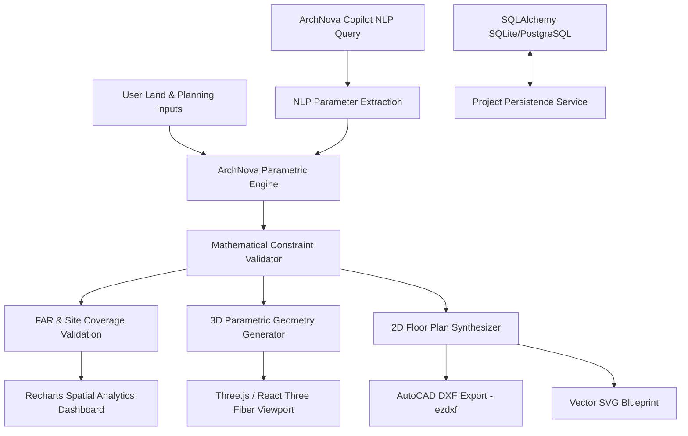

# ArchNova AI — System Architecture & Computational Design Spec

## 1. Executive Overview

ArchNova AI is a full-stack generative design, 3D parametric architecture, and CAD planning platform. It converts land property constraints, zoning setbacks, and functional space requirements into compliant 3D architectural massing envelopes, detailed 2D CAD floor plans, and interactive analytics.



## 2. Monorepo Structural Breakdown

```
archnova-ai/
├── frontend/                     # React 19 + Vite + Three.js application
│   ├── src/
│   │   ├── components/           # Reusable UI cards, modals, navigation
│   │   ├── features/
│   │   │   ├── property/         # 5-step property & planning wizard
│   │   │   ├── floorplan/        # 2D SVG CAD floor plan viewer & tools
│   │   │   ├── validation/       # FAR, site coverage & compliance dashboard
│   │   │   ├── copilot/          # ArchNova Copilot generative chat drawer
│   │   │   ├── exports/          # DXF, SVG, and JSON export dialog
│   │   │   └── projects/         # Project persistence studio manager
│   │   ├── three/                # Three.js 3D WebGL scenes & shaders
│   │   │   ├── BuildingScene.jsx # Main 3D viewport with camera controls
│   │   │   ├── BuildingGeometry.jsx # Procedural walls, slabs, windows, roofs
│   │   │   ├── GroundAndPlot.jsx # Site boundary, setbacks, access roads
│   │   │   └── Landscaping.jsx   # Contextual greenery and vehicle stalls
│   │   ├── services/             # Unified API client & fallback generator
│   │   └── utils/                # Mathematical client-side fallback engine
├── backend/                      # Python FastAPI application
│   ├── app/
│   │   ├── api/                  # REST endpoints (auth, designs, floorplans, exports, projects)
│   │   ├── core/                 # App configuration and security (JWT, bcrypt)
│   │   ├── database/             # SQLAlchemy engine and session
│   │   ├── models/               # User and Project ORM models
│   │   ├── schemas/              # Pydantic validation contracts
│   │   ├── services/
│   │   │   ├── parametric_engine.py  # 3D geometry metadata synthesis
│   │   │   ├── validation_engine.py  # FAR, height, setbacks, coverage validation
│   │   │   ├── floorplan_engine.py   # Deterministic rectangular space layouts
│   │   │   ├── export_engine.py      # AutoCAD DXF (ezdxf) and SVG rendering
│   │   │   └── ai_assistant.py       # Copilot NLP extraction & reasoning
│   │   └── main.py               # FastAPI entry point & CORS configuration
│   └── tests/                    # 13 Automated pytest unit and integration tests
├── docs/                         # Engineering documentation & guidelines
│   ├── architecture.md
│   ├── api.md
│   └── limitations.md
├── docker-compose.yml            # Multi-container orchestration
└── README.md                     # Comprehensive deployment and user guide
```

## 3. Mathematical Foundations

### 3.1 Plot & Envelope Calculations
- **Plot Area**: $A_{\text{plot}} = W_{\text{plot}} \times L_{\text{plot}}$
- **Buildable Width**: $W_{\text{buildable}} = W_{\text{plot}} - (S_{\text{left}} + S_{\text{right}})$
- **Buildable Depth**: $D_{\text{buildable}} = L_{\text{plot}} - (S_{\text{front}} + S_{\text{rear}})$
- **Maximum Theoretical Footprint**: $A_{\text{envelope}} = W_{\text{buildable}} \times D_{\text{buildable}}$
- **Coverage-Capped Footprint**: $A_{\text{coverage}} = A_{\text{plot}} \times \left(\frac{C_{\text{max}}}{100}\right)$
- **Effective Maximum Footprint**: $A_{\text{effective}} = \min(A_{\text{envelope}}, A_{\text{coverage}})$

### 3.2 Floor Area Ratio (FAR/FSI)
- **Proposed Total Floor Area**: $A_{\text{total}} = A_{\text{proposed\_footprint}} \times N_{\text{floors}}$
- **Permitted Gross Floor Area**: $A_{\text{permitted}} = A_{\text{plot}} \times \text{FAR}_{\text{max}}$
- **Proposed FAR**: $\text{FAR}_{\text{proposed}} = \frac{A_{\text{total}}}{A_{\text{plot}}}$

### 3.3 Building Height
- **Building Height**: $H_{\text{total}} = (N_{\text{floors}} \times H_{\text{floor}}) + H_{\text{roof\_structure}}$
- Where standard residential $H_{\text{floor}} = 3.2\,\text{m}$ and parapet $H_{\text{roof\_structure}} = 0.9\,\text{m}$ to $1.8\,\text{m}$.
